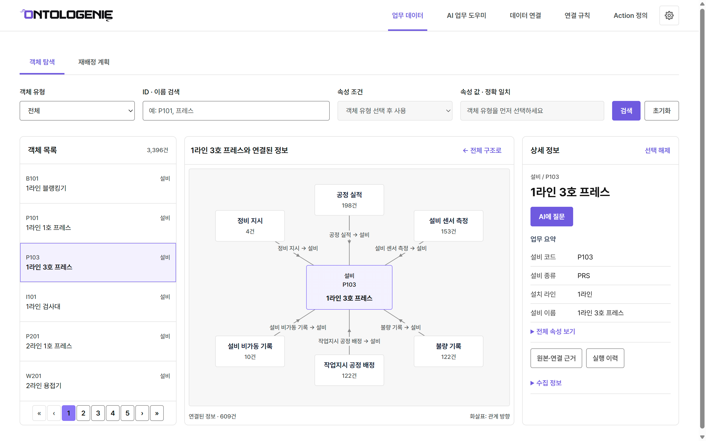
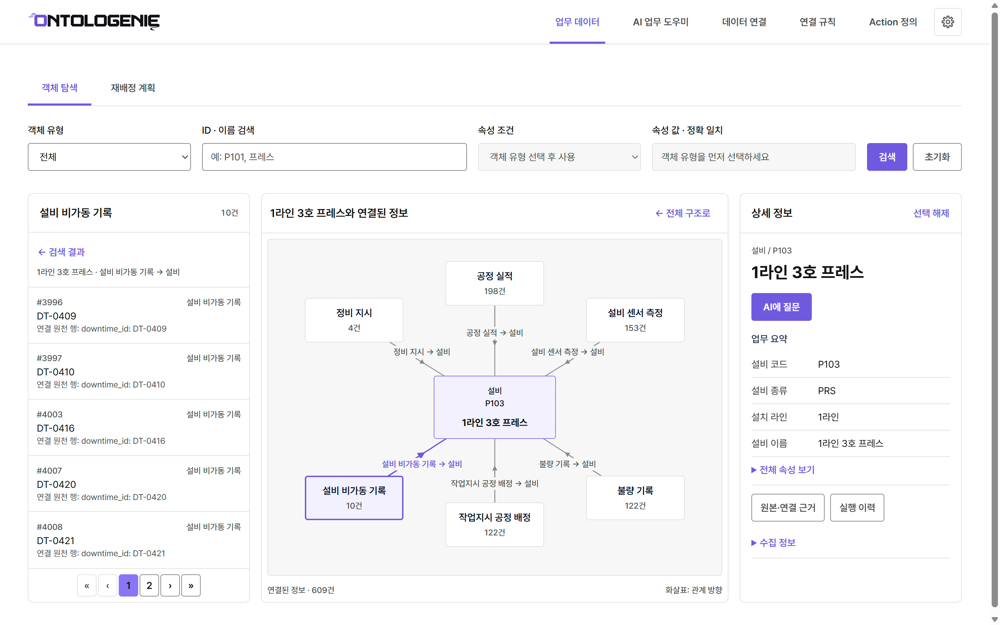
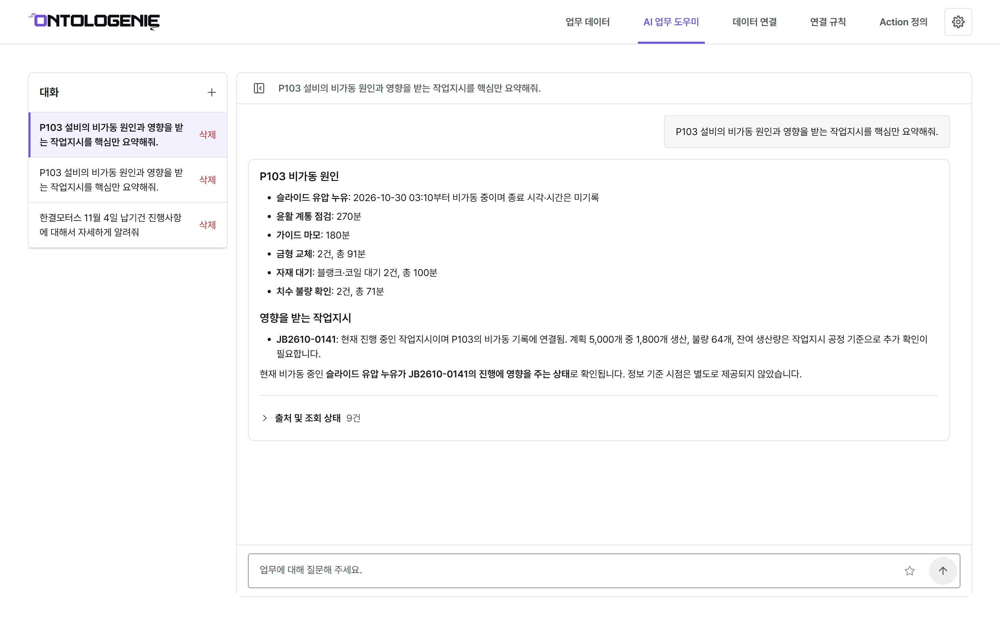
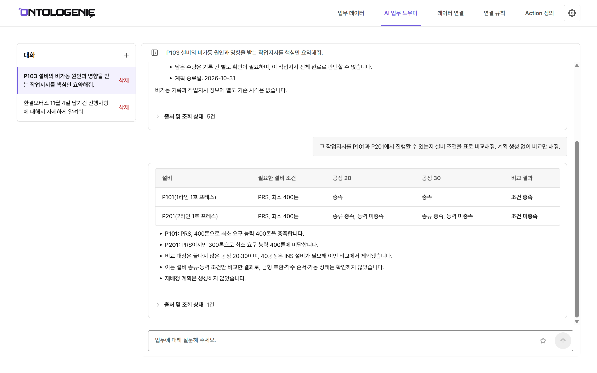
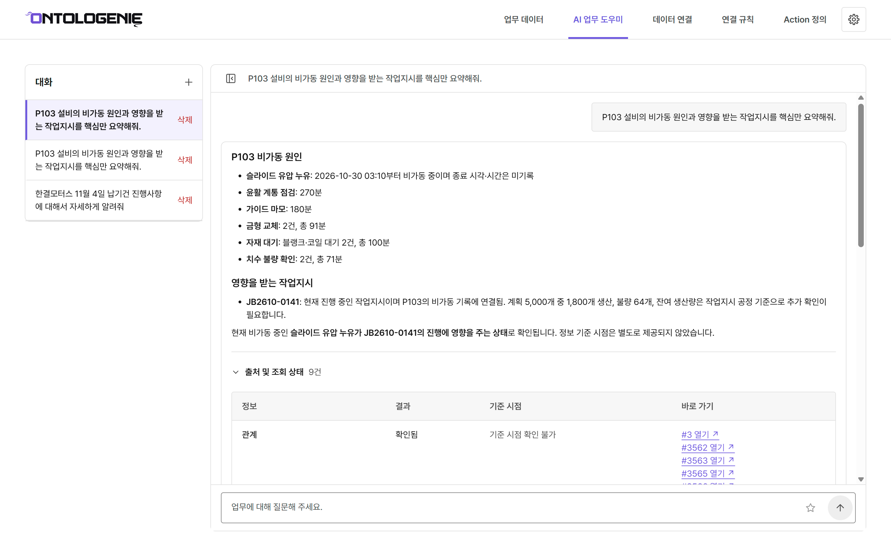
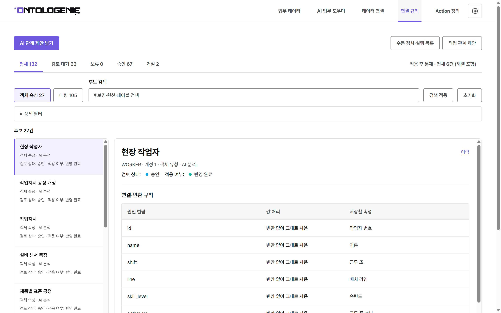
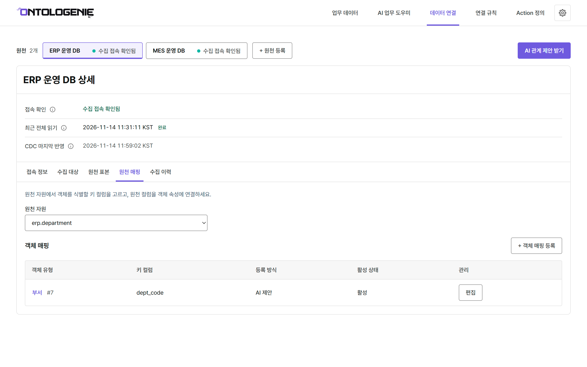
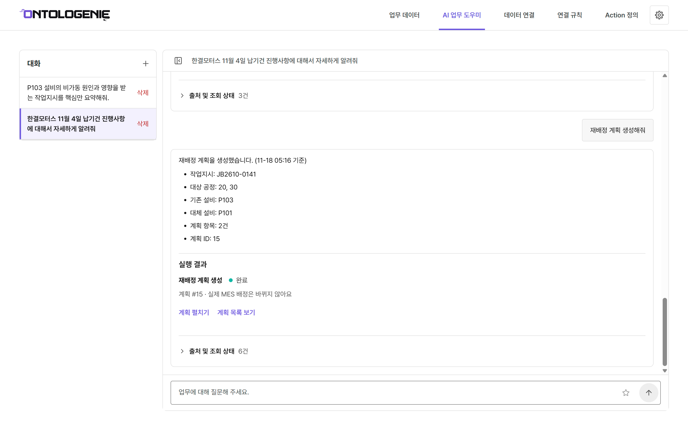
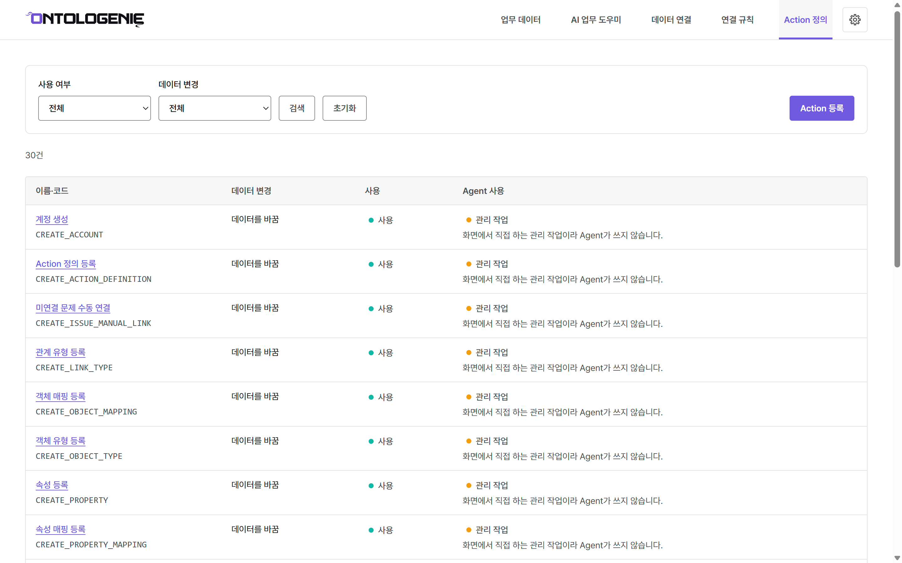
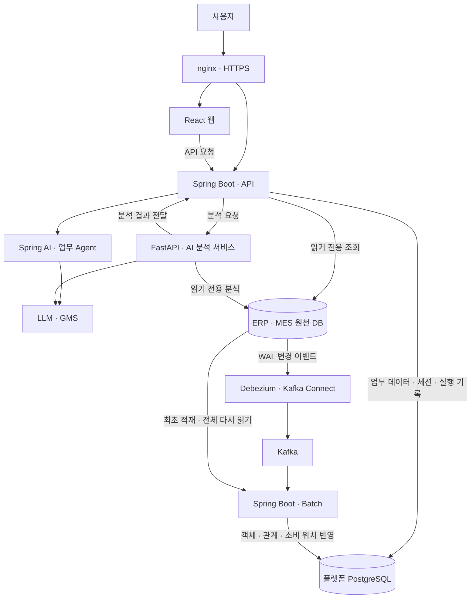

# OntoloGenie · 온톨로지니

### 흩어진 업무 데이터를 연결하고, 근거를 확인하며 AI와 일하는 플랫폼

ERP·MES·현장 메모에 나뉜 제조 데이터를 **객체와 관계로 연결**합니다. 사용자는 관계 그래프로 업무 맥락을 탐색하고, AI에게 자연어로 질문하며, 권한과 업무 조건을 검증한 뒤 재배정 계획을 생성할 수 있습니다.

**SSAFY 기업연계 프로젝트 · 협력기업 에이엑스코어 · 6인 팀**



[서비스](https://ontologenie.com) · [프로젝트 소개](#프로젝트-소개) · [주요 기능과 화면](#주요-기능과-화면) · [시스템 구조](#시스템-구조) · [기술 스택](#기술-스택) · [로컬 실행](#로컬-실행) · [팀 구성](#팀-구성)

## 프로젝트 소개

### 어떤 문제를 해결하나요?

설비 하나가 멈춰도 관련 정보를 찾으려면 여러 시스템을 확인해야 합니다. MES의 설비·작업지시, ERP의 수주·자산, 현장의 정비 메모는 같은 대상을 서로 다른 식별자와 표현으로 기록하기 때문입니다.

OntoloGenie는 이 데이터를 `설비`, `작업지시`, `수주` 같은 업무 객체로 표현하고, 객체 사이의 관계를 정의하는 **온톨로지 레이어**를 제공합니다. 데이터가 어디에서 왔고 어떤 규칙으로 연결됐는지 확인하면서, 조회부터 업무 계획 생성까지 이어갈 수 있습니다.

| 업무에서 필요한 것 | OntoloGenie의 접근 |
| --- | --- |
| 여러 시스템에 흩어진 정보 확인 | 원천 행·컬럼을 공통 객체·속성에 매핑 |
| 서로 다른 코드와 명칭 연결 | AI가 연결·변환 규칙을 제안하고 관리자가 검토 |
| 특정 설비와 관련된 업무 파악 | 객체·관계 그래프와 상세 정보로 탐색 |
| 자연어 질문에 대한 근거 있는 답변 | 허용된 조회 Tool의 결과와 출처를 바탕으로 AI가 답변 |
| 조회 후 실제 업무 처리 | 서버 검증을 거치는 Action으로 플랫폼 안에 계획 저장 |

대상 도메인은 **제조 현장의 프레스 공정**입니다. 시연용 ERP·MES와 현장 메모는 기업 예시 데이터의 구조를 참고해 팀이 새로 만든 데이터입니다. 데이터 구성과 정답셋은 [AI 데이터셋 문서](ai/docs/dataset.md)에서 확인할 수 있습니다.

### 업무 흐름

1. **연결** — 원천 DB를 등록하고 접속 가능 여부와 읽을 수 있는 표·컬럼을 확인합니다.
2. **분석·검토** — AI가 객체 유형·속성·매핑·관계 후보를 제안하면 관리자가 근거와 검사 결과를 검토합니다.
3. **반영·수집** — 승인한 정의와 규칙을 반영하고 원천 데이터를 객체·관계로 수집합니다.
4. **탐색·질문** — 관계 그래프로 데이터를 살펴보거나 AI에게 대상·원인·영향을 질문합니다.
5. **실행·추적** — 허용된 Action으로 재배정 계획을 생성하고 실행 결과와 감사 이력을 확인합니다.

## 주요 기능과 화면

아래 이미지는 **2026년 11월 19일 배포 서비스에서 촬영한 실제 화면**입니다. AI 응답과 데이터 수치는 촬영 당시의 시연 데이터 기준입니다.

### 1. 객체와 관계를 따라가는 업무 데이터 탐색

객체 유형, ID·이름, 속성 조건으로 대상을 검색합니다. 선택한 객체의 관계 그래프와 상세 정보를 함께 보고, 연결된 기록으로 탐색을 이어갈 수 있습니다. 상세 화면에서는 원본·연결 근거, 수집 정보, 실행 이력을 확인하고 선택한 객체를 AI 질문의 맥락으로 전달합니다.

<details>
<summary>설비에서 연결된 비가동 기록으로 탐색하기</summary>



설비를 선택한 상태에서 관계를 누르면 해당 관계로 연결된 객체 목록을 보여줍니다.

</details>

### 2. 조회 근거를 보여주는 AI 업무 도우미

자연어 질문을 해석하고, 필요한 객체·관계·실행 이력을 조회한 뒤 답변합니다. 대상이 모호하면 되묻고, 후속 질문에서는 앞선 업무 조건과 대상을 이어받습니다. 사용자는 답변 아래에서 **출처, 조회 상태, 기준 시점**을 확인하고 관련 객체로 이동할 수 있습니다.

**질문 예시:** “P103 설비의 비가동 원인과 영향을 받는 작업지시를 핵심만 요약해줘.”



**후속 질문 예시:** “그 작업지시를 P101과 P201에서 진행할 수 있는지 설비 조건을 표로 비교해줘. 계획 생성 없이 비교만 해줘.”



<details>
<summary>답변의 출처와 조회 상태 확인하기</summary>



조회 결과를 확인할 수 없는 경우와 기준 시점이 없는 경우도 답변·메타데이터에서 구분합니다. 이 비교 화면에서는 재배정 계획을 생성하지 않았습니다.

</details>

### 3. AI 제안 검토와 온톨로지 관리

AI 분석 결과를 곧바로 활성 데이터로 반영하지 않습니다. 객체 유형·속성·매핑·관계 후보의 근거와 신뢰도를 확인하고, 시험 적용·정합성 검사를 거쳐 승인·거절·보류를 결정합니다. 승인된 내용은 온톨로지에 반영하며 개정 및 검토 이력을 남깁니다.



원천 행의 식별 키와 속성 매핑, 관계의 연결·변환 규칙도 관리합니다. 반영 후 발견된 정합성 문제는 처리 이력과 재검증 결과를 함께 추적합니다.

<details>
<summary>원천 데이터와 업무 객체의 매핑 확인하기</summary>



원천의 표·컬럼을 업무 객체·속성에 연결하고, 수집 이력에서 최초 적재와 후속 수집 결과를 확인할 수 있습니다.

</details>

### 4. 검증된 Action으로 재배정 계획 생성

설비 고장으로 영향을 받는 작업지시를 찾고 대체 설비 조건을 검토한 뒤, `CREATE_REASSIGNMENT_PLAN` Action으로 계획을 생성합니다. 서버가 실행 권한·입력 형식·대상 범위·업무 조건·필요한 확인 여부를 검사합니다.



**재배정 계획은 플랫폼 DB에 저장하며, 원천 MES의 실제 설비 배정을 변경하지 않습니다.** 위 이미지는 기존 대화에 저장된 실행 결과를 촬영한 화면입니다.

<details>
<summary>Action 정의와 Agent 사용 범위 확인하기</summary>



Action의 정의와 실행 Handler를 분리합니다. Agent에는 현재 사용 가능하고, Handler가 구현되어 있으며, 사용자에게 실행 권한이 있는 업무 Action만 제공합니다. 계정·정의 관리 같은 관리 작업은 Agent에 제공하지 않습니다.

</details>

### 5. 원천 변경 수집과 운영 이력 관리

| 기능 | 구현 내용 |
| --- | --- |
| 원천 연결 | 접속 검사, 읽기 범위 확인, 표본 조회, 원천 자격 증명 암호화 |
| 데이터 수집 | 최초 전체 적재, Debezium·Kafka 기반 변경 수집, 전체 다시 읽기 및 예약 수집 |
| 정합성 관리 | 미연결·중복·조건 위반 검사, 문제 처리 이력, 수정 후 재검증 |
| 실행·감사 | Action·Agent 조회·배치 실행 결과와 변경 전후 기록 조회 |
| 계정·권한 | 세션 인증, 역할별 접근 및 데이터 범위 검사, 계정·역할 관리 |

## 시스템 구조



- **API 서버**는 인증·권한, 온톨로지와 검토, 객체 조회, Agent, Action 실행을 담당합니다.
- **AI 분석 서비스**는 원천을 분석해 후보를 생성하고 내부 API로 결과를 전달합니다. 플랫폼 업무 DB에 직접 쓰지 않습니다.
- **Batch 컨테이너**는 수집·검사 등 작업을 처리합니다. API와 같은 백엔드 코드를 사용하되 `batch` 프로필로 분리합니다.
- **업무 Agent**는 Spring Boot 안에서 실행되며 허용된 조회 Tool과 업무 Action을 사용합니다.

### 주요 설계 결정

| 결정 | 이유와 적용 방식 |
| --- | --- |
| 메타모델과 객체 인스턴스 분리 | 객체 유형·속성·관계를 정의하고 원천 데이터를 그 정의에 맞춰 표현합니다. |
| AI 제안과 승인 반영 분리 | 후보·개정·검사 결과를 검토하고, 승인과 반영을 하나의 트랜잭션으로 처리합니다. |
| CDC 반영과 체크포인트를 함께 저장 | 객체 반영에 실패한 작업이 소비 위치만 전진시키지 않도록 합니다. |
| Action 실행의 공통 검증 | 같은 요청 ID의 중복 실행을 방지하고, 실행·차단·실패 결과를 감사 기록으로 남깁니다. |
| 조회 근거와 업무 상태를 답변에 포함 | 답변의 출처, 조회 상태, 기준 시점과 실제 실행 결과를 구분해 제공합니다. |

세부 동작: [CDC 소비](docs/cdc-consumer.md) · [제안 승인·반영](docs/review-decision-execution.md) · [Agent 응답 정책](docs/agent-response-policy.md) · [개발 가이드](docs/development-guide.md)

### CI/CD와 관측

팀 개발 환경은 **GitLab → Jenkins → Docker Compose** 흐름으로 운영합니다. MR 검증과 `develop` 병합 후 배포를 분리하고, 변경된 서비스의 이미지를 빌드해 배포·헬스체크를 수행합니다. Actuator·Prometheus로 상태와 지표를, Alloy·Loki·Grafana로 로그를 확인합니다. 상세 설정은 [인프라 문서](infra/README.md)에 있습니다.

## 기술 스택

실제 의존성·설정 파일 기준입니다.

| 영역 | 기술 |
| --- | --- |
| Frontend | React 19, TypeScript, Vite, React Router, TanStack Query, React Flow, Tailwind CSS |
| Backend | Java 21, Spring Boot 4.1, Spring Data JPA, JdbcClient, Flyway |
| 인증·권한 | Spring Security, Spring Session JDBC, 세션·CSRF 기반 인증 |
| AI Agent | Spring AI 2.0, GMS의 OpenAI 호환 API, Tool Calling |
| AI 분석 | Python 3.11, FastAPI, Pydantic, pandas, psycopg |
| 데이터·배치 | PostgreSQL 18, Spring Batch, Debezium 3.6, Kafka 4.2 |
| 테스트·품질 | JUnit, Mockito, Testcontainers, pytest, Ruff, Vitest, Testing Library, MSW, ESLint, Prettier, Spotless |
| 배포·관측 | AWS Lightsail, Docker Compose, nginx, Let's Encrypt, Jenkins, Actuator, Prometheus, Grafana, Alloy, Loki |

## 저장소 구조

```text
.
├── backend/       # 업무 API · AI Agent · Action · 수집/검사 배치
├── ai/            # AI 분석 서비스 · 시연 데이터 · 정답셋 · 평가
├── frontend/      # 사용자/관리자 React 화면
├── infra/         # 배포 · 원천 DB · CDC · 모니터링 설정
├── docs/          # 개발 가이드 · 기능 설계 · README 화면 캡처
├── .ai/           # 팀 AI 협업 규칙과 작업 절차
├── .gitlab/       # Merge Request 템플릿
└── Jenkinsfile    # 검증·배포 파이프라인
```

## 로컬 실행

필요 환경은 **Node.js 24, JDK 21, Python 3.11**입니다. 백엔드의 Testcontainers 실행과 DB 통합 테스트에는 실행 중인 Docker가 필요합니다. 아래 명령은 각각 저장소 루트에서 시작합니다.

### Frontend · 백엔드 없이 화면 확인

```bash
cd frontend
npm ci
npm run dev
```

`http://localhost:5173`에서 확인합니다. 개발 모드에서는 **MSW의 가짜 API**를 사용하므로 실제 원천 조회·LLM·업무 실행을 검증하는 환경과 구분됩니다. 개발용 로그인과 자세한 설정은 [Frontend README](frontend/README.md)에 있습니다.

### Backend · 임시 PostgreSQL로 API 실행

Windows PowerShell:

```powershell
cd backend
.\gradlew.bat bootTestRun --args='--spring.profiles.active=api'
```

macOS·Linux에서는 `./gradlew bootTestRun --args='--spring.profiles.active=api'`를 사용합니다. Testcontainers가 PostgreSQL을 준비하고 Flyway 마이그레이션을 적용합니다.

Agent LLM, 최초 관리자, 내부 서비스 인증 및 원천 자격 증명 설정은 [backend/.env.example](backend/.env.example)을 참고해 **프로세스 환경변수로 주입**합니다. 기본 설정에서는 Agent LLM이 비활성화되어 있으며, 원천 DB·Kafka·AI 연동은 별도 구성이 필요합니다. `api`는 웹 서버, `batch`는 작업 실행 프로필입니다.

### AI 분석 서비스

Windows PowerShell:

```powershell
cd ai
python -m venv .venv
.\.venv\Scripts\python.exe -m pip install -r requirements.txt
.\.venv\Scripts\python.exe -m uvicorn main:app --port 8000
```

`http://127.0.0.1:8000/health`에서 상태를 확인합니다. 실제 분석에는 LLM·백엔드·원천 연결 설정이 필요합니다. 환경변수는 [ai/.env.example](ai/.env.example), 서비스 연동은 [AI README](ai/README.md)에 정리되어 있습니다.

### 검증 명령

각 서비스 폴더에서 실행합니다. AI 테스트·정적 검사 도구는 `ai/requirements-dev.txt`로 설치합니다.

| 대상 | 명령 |
| --- | --- |
| Frontend | `npm run lint` · `npm test -- --run` · `npm run build` |
| Backend | `./gradlew build` — 전체 테스트와 Spotless 포맷 검사 포함. Windows는 `.\gradlew.bat build` |
| AI | 개발 의존성 설치 후 `python -m pytest` · `ruff check .` · `ruff format --check app tests main.py` |

LLM API 키, DB 비밀번호, 내부 인증 토큰 등 실제 비밀값은 커밋하지 않습니다. 환경 설정 예시는 값의 형식을 안내하기 위한 파일입니다.

## 팀 구성

| 이름 | 담당 영역 | 주요 책임 |
| --- | --- | --- |
| 김산이 | Backend | Action 실행·검증, 권한, 감사 기록, 수집 배치 |
| 이주헌 | Backend | 온톨로지 정의, 원천 매핑, 연결 규칙, 정합성 검사·문제 관리 |
| 정유림 | Backend | 제안 검토·승인·반영, 규칙 시험 적용·재검증, 객체 탐색 조회 |
| 김서연 | AI | 원천 연결, AI 분석·제안, 시연 데이터·평가 |
| 장민화 | AI Agent · Frontend | AI Agent, 사용자 화면 |
| 손주연 | Frontend · Infra | 관리자 화면, 서버·배포 환경 |

## 관련 문서

| 문서 | 내용 |
| --- | --- |
| [개발 가이드](docs/development-guide.md) | 팀 컨벤션, 인증·권한, 계층 구조, 데이터·작업 처리 규칙 |
| [AI 서비스](ai/README.md) · [분석 연동](ai/docs/api-internal.md) | 분석 엔진, 백엔드 내부 API 계약, 실행 방법 |
| [AI 제안 평가](ai/docs/evaluation.md) · [Agent 모델 평가](docs/agent-model-evaluation.md) | 데이터셋, 평가 기준, 실험 결과와 한계 |
| [Agent 응답 정책](docs/agent-response-policy.md) | 질문 해석, 되묻기, 조회·답변·실행 정책 |
| [원천 변경 통합 검증 기록](docs/integration-verification-241.md) | 수집·재분석·재검증의 기존 시나리오 검증 기록 |
| [Frontend](frontend/README.md) · [인프라](infra/README.md) | 화면 개발과 배포 환경 상세 |
| [팀 기준 문서 안내](.ai/references.md) | Notion 기능 명세서·API 명세서·ERD 및 Jira 위치 |
